<div align="center">

  

  # 🤖 Awesome Generative AI Assistant

  <p align="center">
    <strong>A curated directory of top-tier Enterprise Copilots, Autonomous Agentic Assistants, Workplace AI Platforms &amp; Sovereign Self-Hosted LLM Frameworks.</strong>
  </p>

  <p align="center">
    <a href="https://github.com/ishandutta2007/Awesome-Awesome-Awesome"></a><a href="https://discord.gg/jc4xtF58Ve"></a>
    <a href="https://github.com/ishandutta2007/Awesome-Generative-AI-Assistant/stargazers"></a>
    <a href="https://github.com/ishandutta2007/Awesome-Generative-AI-Assistant/network/members"></a>
    <a href="https://github.com/ishandutta2007/Awesome-Generative-AI-Assistant/blob/main/LICENSE"></a>
    <a href="https://github.com/ishandutta2007/Awesome-Generative-AI-Assistant/pulls"></a>
    <a href="https://github.com/ishandutta2007"></a>
  </p>

</div>

---

## 📖 Overview &amp; Architectural Landscape

In modern digital enterprises, **Generative AI Assistants** and **Autonomous Enterprise Copilots** have evolved from rudimentary conversational chatbots into mission-critical, context-aware operational teammates. These systems combine foundational Large Language Models (LLMs), high-density Retrieval-Augmented Generation (RAG), and multi-step reasoning loops to automate complex business workflows, execute cross-application tool calls via standard interfaces like the **Model Context Protocol (MCP)**, and deliver grounded, citeable resolutions.

A resilient enterprise AI assistant architecture integrates five foundational layers:
1. **Context-Aware Semantic Grounding (RAG)**: Multi-modal document parsers, hybrid sparse/dense vector search, and organizational permission graphs ensuring that AI responses mirror live enterprise data without leaking confidential access across departments.
2. **Deterministic &amp; Agentic Reasoning Engines**: Multi-agent coordination pipelines where supervisory agents plan, delegate tasks to specialized sub-agents, enforce business guardrails, and execute remediation actions autonomously.
3. **Universal Tool Execution &amp; Interoperability (MCP / APIs)**: Standardized connectors and secure sandboxes executing live database operations, ticketing modifications (ITSM/CRM), code execution, and SaaS workflow triggers.
4. **Enterprise Governance, Identity &amp; Observability**: Strict Role-Based Access Control (RBAC), SSO/SAML/OIDC authentication, SCIM provisioning, real-time prompt injection defense, and full cryptographic audit logging.
5. **Flexible Deployment Topology**: The spectrum between hyper-scalable commercial SaaS copilots embedded in operational platforms and air-gapped, sovereign open-source stacks ensuring complete data residency and zero per-seat licensing penalties.

---

## 📑 Table of Contents

- [🌐 Sector Overview &amp; Market Dynamics](#-sector-overview--market-dynamics)
- [☁️ SaaS &amp; Commercial Enterprise Copilots](#️-saas--commercial-enterprise-copilots)
- [🔓 Open-Source GitHub Projects (Ranked by Stars)](#-open-source-github-projects-ranked-by-stars)
- [📊 Architectural Comparison Matrix](#-architectural-comparison-matrix)
- [🤝 How to Contribute](#-how-to-contribute)
- [📈 Star History](#-star-history)
- [💖 Support &amp; Sponsorship](#-support--sponsorship)
- [⚖️ Disclaimer](#️-disclaimer)

---

## 🌐 Sector Overview &amp; Market Dynamics

The global **Generative AI Assistant and Intelligent Virtual Assistant (IVA) market** was valued at approximately **$19.8 Billion in 2024** and is projected to expand to **$108.5 Billion by 2030**, exhibiting an extraordinary Compound Annual Growth Rate (**CAGR of ~32.5%**). This exponential acceleration is propelled by enterprise adoption of autonomous agentic copilots, native generative deflection across IT/HR/Customer support desks, and widespread integration of the Model Context Protocol (MCP) enabling LLMs to execute real-world actions.

Market concentration follows a distinct two-tier competitive structure:
1. **Core Operating Systems &amp; Systems-of-Record (Highly Concentrated / Winner-Take-Most)**: The generalized workplace copilot and core enterprise platform tier is heavily dominated by mega-cap incumbents—namely **Microsoft (Copilot)**, **Salesforce (Agentforce)**, and **ServiceNow (Now Assist)**. These giants leverage massive pre-existing distribution networks, deep identity integrations (Active Directory/Entra, CRM, ITSM), and unified customer context that present formidable barriers to standalone generalists.
2. **Domain-Specialized Copilots &amp; Sovereign Open-Source (Moderately Fragmented)**: The cognitive search, vertical automation, and sovereign deployment layers remain vigorously competitive and fragmented. High-growth innovators like **Glean** command leadership in cross-silo enterprise search, while **Moveworks**, **Kore.ai**, **Ada**, and **Forethought** fiercely compete on domain-specific resolution accuracy and voice automation. Simultaneously, the open-source and self-hosted ecosystem (anchored by **Dify**, **Open WebUI**, **RAGFlow**, **AnythingLLM**, and **LibreChat**) thrives among privacy-conscious enterprises, financial institutions, and defense organizations enforcing air-gapped data sovereignty.

---

## ☁️ SaaS &amp; Commercial Enterprise Copilots

The table below catalogs premier commercial SaaS solutions for enterprise AI copilots and agentic assistants, sorted in descending order by **Company Scale (Valuation / Market Cap / Revenue)**.

| Platform / Copilot | Company Scale (Revenue / Valuation) 🔽 | Starting Tier Pricing | Free Tier Limits &amp; Trials | Core AI Assistant Capabilities |
| :--- | :--- | :--- | :--- | :--- |
| **[Microsoft Copilot](https://www.microsoft.com/en-us/microsoft-copilot)** | **~$3.15T Market Cap**<br>($245.1B Annual Revenue) | **$20.00 / user / mo**<br>*(Copilot Pro individual)* or **$30.00 / user / mo** *(Copilot for M365 Business)* | **Free forever tier** (web/mobile chat with standard LLM reasoning &amp; web grounding); **30-day free trial** for M365 Business (up to 25 seats with full Office 365 app copilot integration) | Workplace AI coworker deeply integrated across Word, Excel, Teams, Outlook, and Dynamics 365; Work IQ enterprise context grounding, Copilot Studio agent builder, and cloud-hosted Autopilot teammate |
| **[Salesforce Agentforce](https://www.salesforce.com/agentforce/)** | **~$290B Market Cap**<br>($37.9B Annual Revenue) | **$2.00 / conversation**<br>*(Customer service agent)* or **$0.10 / action** *(Flex Credits at $500 per 100k credits)* | **Salesforce Foundations $0 plan** (includes 250 to 100,000 complimentary Flex Credits for testing/PoC); **30-day developer platform trial** with full sandbox access | Autonomous agentic platform with pre-built job personas (Casey, Paige, Hunter, Fin), Atlas Reasoning Engine, Customer 360 CRM grounding, and Agent Script for deterministic + LLM reasoning |
| **[ServiceNow Now Assist](https://www.servicenow.com/)** | **~$190B Market Cap**<br>($11.5B Annual Revenue) | **$100.00 / user / mo**<br>*(ITSM Pro Plus add-on license tier)* or **$1.50 - $2.50 per assist pack consumption** | **Free Personal Developer Instance (PDI)** with full admin API access and Now Assist skill testing (hibernates after 10 days of inactivity); **30-day enterprise evaluation PoC** | Enterprise GenAI suite spanning ITSM, HR, and Customer Workflows; Build Agent with Model Context Protocol (MCP) clients (Figma, Linear, Prisma), incident summarization, and KB creation |
| **[Glean](https://www.glean.com/)** | **~$7.2B Valuation**<br>($100M+ ARR, Series F) | **$45.00 / user / mo**<br>*(Core Enterprise Search &amp; Chat billed annually; ~$54,000/yr ACV baseline for 100 seats)* | **30-day structured Proof of Concept (PoC) pilot** for qualified enterprises (evaluates up to 100 test seats and 5 native connectors; no public credit-card trial) | Enterprise cognitive search and unified AI coworker connecting to 100+ SaaS tools; deep permission-aware graph grounding, grounded citations, Slack/browser assistant, and MCP integration |
| **[Moveworks](https://www.moveworks.com/)** | **~$2.85B Valuation**<br>($100M+ ARR, ServiceNow subsidiary) | **$12.50 / employee / mo**<br>*(AWS Marketplace benchmark band for 1,000–2,500 employees at $150/emp/yr)* | **30-day guided Proof of Concept (PoC)** sandbox with AI ticket deflection analysis on historical enterprise data (no public self-serve free tier; sales alignment required) | Autonomous employee AI front door for IT, HR, and Finance; conversational resolution engine across Slack/Teams, FedRAMP Moderate GovCloud, and 100+ language real-time translation |
| **[Kore.ai](https://kore.ai/)** | **~$1.2B Valuation**<br>($100M+ ARR, FTV Capital) | **$0.20 / conversation session**<br>*(15-min session increment, $100/mo minimum commitment)* or **$50.00 / agent / mo** | **Free forever development tier** (unlimited bot building &amp; testing on Kore XO Platform until published); **$500 free trial credits** valid for 90 days; **14-day Automation AI trial** (up to 2,000 sessions) | Enterprise Agent Platform (Artemis edition) with Agent Blueprint Language (ABL); Dual-Brain Architecture pairing agentic LLM reasoning with deterministic business flows |
| **[Ada](https://www.ada.cx/)** | **~$1.2B Valuation**<br>($50M+ ARR, Series C) | **$2,500.00 / month**<br>*(Core plan billed annually at $30,000/yr, including up to 2,000 automated conversations/mo)* | **14-day sales-guided Proof of Concept (PoC)** sandbox environment with synthetic customer query replay and deflection rate simulation (no permanent free tier) | Agentic customer experience and voice AI platform connecting to CRM, inventory, and reservation systems; automated zero-touch resolution across Messaging, Voice, and Email in 60+ languages |
| **[Forethought](https://forethought.ai/)** | **~$500M Valuation**<br>($30M+ ARR, Series C) | **$2,916.00 / month**<br>*(Team plan billed annually at $35,000/yr baseline + outcome-based resolution fees)* | **30-day guided Proof of Value (POV)** simulation analyzing up to 20,000 historical support tickets with deflection modeling (no permanent free tier) | Agentic generative customer support suite (Solve, Triage, Assist, Discover); Autoflows for voice and chat ticket resolution, CRM routing, and automated knowledge discovery |
| **[Aisera](https://aisera.com/)** | **~$500M Valuation**<br>($30M+ ARR, Automation Anywhere) | **$16.66 / user / mo**<br>*(AI Service Desk baseline band for 1,000 users at $200k/yr on Azure Marketplace)* | **30-day enterprise evaluation pilot** with sample IT/HR ticket ingestion and LLM confidence scoring sandbox (no permanent free tier; 1st month free promotional credit on annual Azure contracts) | Multi-agent AI platform for ITSM and ESM; Universal, Domain, and Task agents executing autonomous incident triage, root cause analysis, and CMDB self-healing via RLHF |
| **[Yellow.ai](https://yellow.ai/)** | **~$450M Valuation**<br>($30M+ ARR, Series C) | **$0.99 / resolution**<br>*(Pay-as-you-go above free tier)* or **$499.00 / mo** *(Enterprise starter package)* | **Free forever plan** supporting **1 AI Agent**, up to **500 chat/email sessions per month**, 1,000 User360 records, 2 channels, and 1 active campaign | Dynamic AI agent platform featuring Nexus EDGE desktop interface for live screen perception and local system remediation; multi-channel deployment across 35+ channels |

---

## 🔓 Open-Source GitHub Projects (Ranked by Stars)

Sovereign, community-driven, and self-hosted open-source AI assistants, chat platforms, and agent orchestration engines. Entries are sorted in descending order by **GitHub Stars Count**, with live social star badges linking directly to each project's stargazers community.

- **[Dify](https://github.com/langgenius/dify)** [](https://github.com/langgenius/dify/stargazers)  
  *Leading Open-Source LLM App Development Platform &amp; Agentic Workflow Orchestrator (Apache-2.0 / Self-Hosted)*  
  A visual, production-grade LLM application development platform unifying visual workflow building, RAG pipelines, agent capabilities, and multi-model routing. Supports Chatbot, Agent, Chatflow, and Text Generator archetypes with hundreds of LLM providers and zero-code tool bindings.

- **[Open WebUI](https://github.com/open-webui/open-webui)** [](https://github.com/open-webui/open-webui/stargazers)  
  *Extensible, Feature-Rich Self-Hosted AI Interface &amp; Multi-Model Workspace (BSD-3)*  
  A user-friendly, team-centric web interface supporting Ollama, OpenAI-compatible APIs, and local models. Features integrated RAG with 13+ vector databases, multi-agent model presets with tool calling, team channels, granular RBAC, SSO/OIDC/LDAP, SCIM 2.0 provisioning, and an Open Terminal for code execution.

- **[RAGFlow](https://github.com/infiniflow/ragflow)** [](https://github.com/infiniflow/ragflow/stargazers)  
  *Vision-Native Enterprise Retrieval-Augmented Generation (RAG) Engine (Apache-2.0)*  
  An open-source RAG engine built on deep document understanding via DeepDoc. Parses complex multi-column PDFs, tables, slides, and scanned forms into structured semantic chunks. Minimizes hallucinations through citeable grounding, agentic workflow coordination, and Model Context Protocol (MCP) integrations.

- **[LobeChat](https://github.com/lobehub/lobe-chat)** [](https://github.com/lobehub/lobe-chat/stargazers)  
  *Modern Open-Source Multi-Model Chat &amp; Autonomous Agent Workspace (Apache-2.0)*  
  A high-aesthetic conversational framework supporting OpenAI, Anthropic, Gemini, DeepSeek, and Ollama. Delivers an extensive Agent Market, visual plugin ecosystem, multi-modal vision synthesis, Text-to-Speech (TTS), artifact rendering, and server-side PostgreSQL persistence with Docker/Vercel deployment.

- **[AnythingLLM](https://github.com/Mintplex-Labs/anything-llm)** [](https://github.com/Mintplex-Labs/anything-llm/stargazers)  
  *All-in-One Private AI Assistant with Multi-User Document Intelligence (MIT)*  
  Full-stack local AI assistant offering desktop (single-user) and Docker (multi-user) editions. Features a smart Model Router for hybrid cloud/local dispatch, scheduled autonomous agent jobs via visual Cron Builder, multi-workspace isolation, automatic memory extraction, and native web scraping.

- **[PrivateGPT](https://github.com/zylon-ai/private-gpt)** [](https://github.com/zylon-ai/private-gpt/stargazers)  
  *Production-Ready API &amp; Local Assistant for 100% Private Document Question-Answering (Apache-2.0)*  
  Constructed on top of FastAPI and LlamaIndex to deliver an air-gapped, zero-data-leakage enterprise assistant. Ingests local files without internet connectivity, offers OpenAI-compatible REST endpoints, supports local GGUF/Ollama inference, and integrates with secure corporate data repositories.

- **[Flowise](https://github.com/FlowiseAI/Flowise)** [](https://github.com/FlowiseAI/Flowise/stargazers)  
  *Drag-and-Drop Visual UI for Building LLM Flows &amp; Multi-Agent Assistants (MIT)*  
  Node-based visual builder enabling teams to assemble custom LangChain agents, conversational retrieval pipelines, auto-evaluators, and tool-calling copilots. Features embedded chat widgets, custom tool nodes, and instant API deployment.

- **[LocalAI](https://github.com/mudler/LocalAI)** [](https://github.com/mudler/LocalAI/stargazers)  
  *Drop-in Open-Source OpenAI Replacement for Local Multi-Modal Assistant Inference (MIT)*  
  The sovereign AI engine enabling self-hosted assistants to run LLMs, vision-language models, whisper audio transcription, embeddings, and image generation locally on consumer hardware without GPU dependencies. Acts as the core inference backbone for private assistants.

- **[LibreChat](https://github.com/LibreChat-AI/LibreChat)** [](https://github.com/LibreChat-AI/LibreChat/stargazers)  
  *Enterprise-Grade Open-Source ChatGPT / Claude Alternative with Agents &amp; MCP (MIT)*  
  A scalable, self-hosted chat platform integrating OpenAI, Anthropic, Google, Azure, AWS Bedrock, and local models. Features autonomous AI Agents with custom tool execution, sandboxed Code Interpreter (Python/Node/Go/Java/Rust), Model Context Protocol (MCP) clients, multi-modal chat, artifact generation, and enterprise SSO (SAML/OAuth/LDAP).

- **[Langchain-Chatchat](https://github.com/chatchat-space/Langchain-Chatchat)** [](https://github.com/chatchat-space/Langchain-Chatchat/stargazers)  
  *Sovereign Local Knowledge Base QA &amp; Conversational Enterprise Assistant (Apache-2.0)*  
  Popular localized enterprise knowledge assistant leveraging LangChain, Milvus/Chroma, and open-source foundation models (ChatGLM, Qwen, Llama). Delivers full offline data processing, tabular data analysis, and multi-document synthesis for sovereign enterprise intranets.

- **[Khoj](https://github.com/khoj-ai/khoj)** [](https://github.com/khoj-ai/khoj/stargazers)  
  *Personal AI Second Brain &amp; Cross-Platform Workplace Assistant (AGPL-3.0)*  
  A self-hostable personal assistant that indexes notes, markdown files, PDFs, GitHub repositories, and web bookmarks. Operates across Desktop, Web, Obsidian, Emacs, and WhatsApp with deep semantic search, speech synthesis, and offline reasoning capabilities.

- **[WorkWit AI Agent](https://github.com/crane-in-clear-sky/WorkWit-AI-Agent)** [](https://github.com/crane-in-clear-sky/WorkWit-AI-Agent/stargazers)  
  *Self-Hosted Enterprise Office Automation Agent Platform (MIT)*  
  An open-source AI agent system dedicated to office workflows including automated contract review, resume screening, multi-step goal planning, and sub-agent delegation. Features a sandboxed Skills Marketplace and multi-tenant RBAC.

- **[NEST Hub](https://github.com/contextzero/nest_hub)** [](https://github.com/contextzero/nest_hub/stargazers)  
  *Air-Gapped Autonomous Workforce Platform with Governed Multi-Agent Orchestration (Fair-Code)*  
  A sovereign multi-agent platform supporting 700+ BYOK models, persistent organizational memory (HIVE), mandatory human-in-the-loop review (MISSION CONTROL), computer-use execution (OPERATOR), and cryptographic audit trails for air-gapped environments.

---

## 📊 Architectural Comparison Matrix

| Platform / Framework | Architecture &amp; Hosting | Agentic Autonomy Level | Enterprise RAG / Grounding | Tool Calling &amp; MCP | Identity &amp; RBAC | Primary Best-Fit Workload |
| :--- | :--- | :--- | :--- | :--- | :--- | :--- |
| **Microsoft Copilot** | Managed SaaS (Azure) | Semi-Autonomous / Copilot | Native Work IQ Graph | Graph APIs &amp; Copilot Studio | Entra ID / Enterprise E5 | Unified Microsoft 365 enterprise office workflows |
| **Salesforce Agentforce** | Managed SaaS (Salesforce) | Fully Autonomous Agents | Customer 360 &amp; Data Cloud | Agent Script &amp; Flow Actions | Salesforce RBAC &amp; Profiles | CRM, sales prospecting, and customer contact center |
| **ServiceNow Now Assist** | Managed SaaS (ServiceNow) | Autonomous &amp; Supervised | Enterprise Platform CMDB | Native MCP Client &amp; REST | ServiceNow Roles &amp; Groups | Global 2000 ITSM, HR service delivery, and ESM |
| **Glean** | Managed Enterprise SaaS | Semi-Autonomous Assistant | 100+ Enterprise Connectors | MCP Support &amp; Webhooks | Native Okta, Google, Azure SSO | Enterprise-wide cognitive search &amp; knowledge worker assistant |
| **Moveworks** | Managed SaaS (FedRAMP) | Autonomous Deflection | Deep ITSM / HR Ingestion | REST &amp; Webhook Triggers | Enterprise SAML / SCIM | Zero-touch IT/HR request deflection in Slack/Teams |
| **Kore.ai** | Hybrid SaaS / On-Prem | Dual-Brain Multi-Agent | Enterprise Knowledge Graph | Dialog Flows &amp; Tool APIs | Multi-Tenant Enterprise RBAC | Omnichannel customer service and conversational AI |
| **Dify** | Self-Hosted / Open-Source | Visual Multi-Agent Flows | Hybrid Vector Search + Rerank | Built-in Tools &amp; OpenAPI | Team Workspaces &amp; Roles | Visual development of custom agentic apps &amp; RAG |
| **Open WebUI** | Self-Hosted / Docker | Presets &amp; Tool Binding | 13+ Vector DBs &amp; Hybrid RAG | Python Functions &amp; MCP | SSO / OIDC / LDAP / SCIM | Self-hosted multi-user LLM interface for teams |
| **RAGFlow** | Self-Hosted / Open-Source | Agentic Document Parsing | DeepDoc Vision Parser | Agentic Workflows &amp; MCP | Workspace Project Isolation | High-precision document RAG with complex PDFs/tables |
| **LibreChat** | Self-Hosted / Kubernetes | Autonomous Sub-Agents | Vector Search &amp; File Ingestion | Native MCP Client &amp; Code Sandbox | SAML, OAuth, LDAP &amp; RBAC | Secure multi-model ChatGPT/Claude replacement for enterprise |
| **AnythingLLM** | Desktop &amp; Self-Hosted | Scheduled Agent Jobs | Built-in Multi-Vector Store | Custom Agent Skills &amp; MCP | Workspace-Level Access Control | Local-first, private desktop &amp; team knowledge assistant |
| **PrivateGPT** | Air-Gapped / Self-Hosted | Single-Turn Contextual | Local LlamaIndex Ingestion | Extensible Skill Endpoints | Network Perimeter / API Tokens | Strict air-gapped data sovereign deployments |

---

## 🤝 How to Contribute

Contributions, tool recommendations, and documentation enhancements are highly encouraged!

1. **Fork the repository** to your personal GitHub account.
2. **Create a descriptive feature branch**:
   ```bash
   git checkout -b feat/add-generative-ai-assistant
   ```
3. **Commit your modifications** ensuring clear, factual pricing, trial details, official links, and clean Markdown table formatting.
4. **Push the branch** and **open a Pull Request** with a concise summary of your additions.

---

## 📈 Star History

[](https://star-history.dera.page/#ishandutta2007/Awesome-Generative-AI-Assistant&type=date&legend=top-left)

---

## 💖 Support &amp; Sponsorship

If you find this curated Generative AI Assistant ecosystem directory valuable for your organization, AI workflows, or open-source infrastructure:

- ⭐ **Star this repository** on GitHub to amplify its reach and visibility!
- 🍴 **Fork the repo** to maintain your personal reference copy.
- 📢 **Share with fellow AI engineers**, platform architects, CTOs, and tech leaders.
- ☕ **Support continuous maintenance &amp; research** by sponsoring via the link below:

<p align="center">
  <a href="https://github.com/sponsors/ishandutta2007">
    
  </a>
</p>

---

## ⚖️ Disclaimer

- This repository is an independent, **community-curated index** created solely for architectural, informational, and educational purposes. Mention of specific vendors, commercial products, or open-source repositories does not constitute an official endorsement.
- Pricing, subscription minimums, and trial policies are subject to rapid modification by respective vendors. Always consult official vendor product pages and master service agreements for real-time contractual commitments.
- Self-hosted open-source software requires rigorous vulnerability scanning, secure secret management, and network sandboxing before production rollout.
- Review software license terms (MIT, Apache-2.0, BSD-3, AGPL-3.0, Fair-Code) prior to enterprise adoption or proprietary commercial distribution.

---

<p align="center">
  <strong>Crafted with ❤️ for AI platform engineers, enterprise architects, and builders shaping the future of autonomous intelligence.</strong>
</p>
